<!-- ███ ARTHUR MARTINS · ZarthDev ███ -->

<p align="center">
  
</p>

<p align="center">
  
</p>

<p align="center">
  <a href="https://zarthdev.netlify.app"></a>
  <a href="https://www.linkedin.com/in/arthur-martins-2720782b7/"></a>
  <a href="mailto:arthurteixeiramartins310807@gmail.com"></a>
  <a href="https://wa.me/5551986928804"></a>
  <br>
  
</p>

<p align="center"><code>Estagiário de Infraestrutura de TI @ Appmax</code> · <code>ADS @ Unisinos</code> · <code>Porto Alegre, RS 🇧🇷</code></p>


## &#128075;&#160; Sobre mim

```php
<?php
$arthur = new Dev([
    'papel'      => 'Infraestrutura de TI & Desenvolvedor Full Stack',
    'empresa'    => 'Appmax — suporte, ativos, virtualização e ferramentas internas',
    'formacao'   => 'Análise e Desenvolvimento de Sistemas (Unisinos)',
    'base'       => ['PHP', 'C#', 'JavaScript'],
    'aprendendo' => ['Docker', 'PostgreSQL', 'redes', 'arquitetura de software'],
    'lema'       => 'Da infraestrutura ao pixel, cada camada importa.',
    'autodidata' => true,
]);
```

- 🏢 Vivo os dois lados: **mantenho a infraestrutura** (suporte, gestão de ativos, virtualização, redes, backups) **e construo as ferramentas internas** que o time de T.I usa todo dia.
- 🛠️ Mais forte em **PHP, C# e JavaScript**; gosto de solução **simples, funcional e bem estruturada**.
- 📚 Boa parte da formação é **autodidata** — tanto em programação quanto em inglês.
- 🚀 Hoje me aprofundando em **Docker, PostgreSQL, redes, mensageria e arquitetura**.


## &#129302;&#160; Stack

> Uma paleta só, do kernel ao pixel — minha "home screen" de tecnologias:

<p align="center">
  
</p>


## &#128202;&#160; GitHub em números

<p align="center">
  
  
  
</p>

<p align="center">
  
</p>


## &#128302;&#160; Projetos em destaque

<p align="center">
  <a href="https://zarthdev.netlify.app"></a>
  <a href="https://github.com/ZarthDev/portfolio"></a>
  <a href="https://github.com/ZarthDev/portfolio"></a>
</p>

- 🎨 **[Portfólio](https://zarthdev.netlify.app)** — site pessoal em HTML/CSS/JS puro, paleta bordô, com o mini-game *Flappy ElePHPant*. Deploy na Netlify.
- 📰 **inKernel** *(em desenvolvimento)* — blog técnico em React, 100% na borda da **Cloudflare** (Worker + Hono, D1 e KV).
- 🧰 **Ferramentas internas de T.I** — dashboards, bots de Slack (Socket Mode) e plugins de GLPI 11 que automatizam o dia a dia da operação (PHP · Go · Docker · GitLab CI/CD).


## &#127919;&#160; No foco agora

```text
[██████████░░] Docker & orquestração de containers
[████████░░░░] PostgreSQL & modelagem de dados
[███████░░░░░] Redes, TLS e observabilidade
[██████░░░░░░] Mensageria idempotente (Kafka · RabbitMQ)
[█████░░░░░░░] Arquitetura de software & boas práticas
```

<p align="center">
  
</p>
